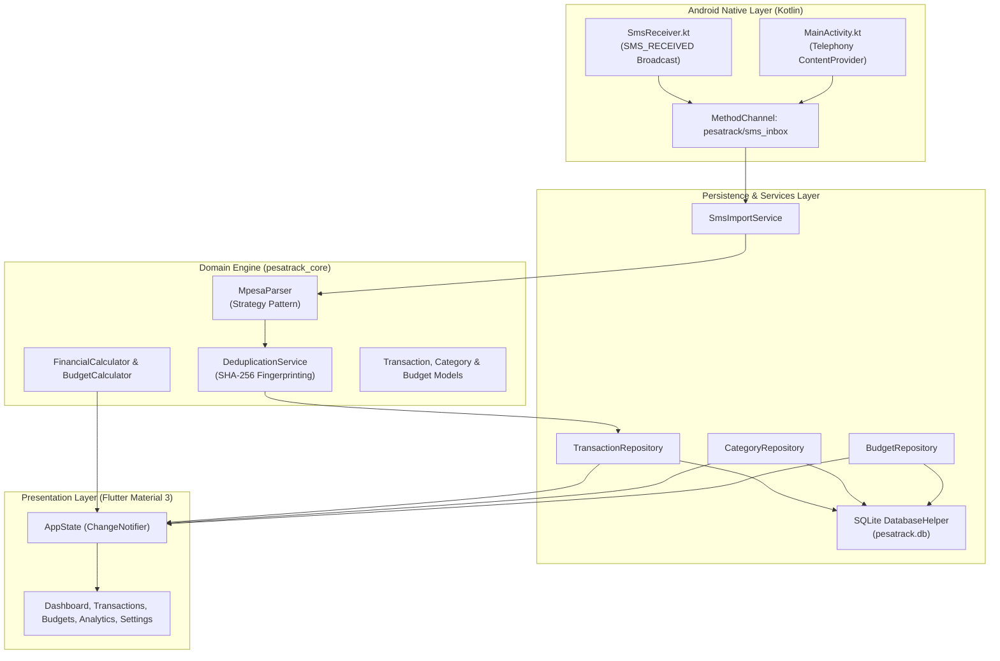

# PesaTrack System Architecture

This document describes the software architecture, design principles, data flow, and on-device storage design of **PesaTrack (GanjiTrace)**.

---

## 🏗️ High-Level Architecture

PesaTrack follows a strict layered, offline-first architecture designed to separate domain financial logic from Flutter UI rendering and Android platform-specific capabilities.

---

## 🧩 Architectural Layers

### 1. Pure Dart Domain Engine (`packages/pesatrack_core`)
The business logic is completely isolated from Flutter and Android APIs:
- **Zero UI Dependencies:** Can be executed and tested using pure `dart test`.
- **Strategy Pattern Parsers:** Each M-Pesa transaction type is handled by a dedicated strategy (`SendMoneyStrategy`, `ReceiveMoneyStrategy`, `PayBillStrategy`, `BuyGoodsStrategy`, `WithdrawAgentStrategy`, `WithdrawAtmStrategy`, `DepositStrategy`, `AirtimeStrategy`, `ReversalStrategy`).
- **Integer Minor Units:** All monetary amounts are stored strictly as integers in minor units (cents: `100 cents = 1 KES`). This completely eliminates IEEE-754 floating-point rounding errors in cash flow calculations.
- **Deterministic Deduplication:** Generates SHA-256 hashes (`DeduplicationService`) using the official M-Pesa reference (`REF:<CODE>`), or normalized composite keys (`COMP:<type>:<amount>:<timestamp>:<counterparty>:<account>`) when references are omitted.

### 2. Native Android Integration (`android/app/src/main/kotlin/...`)
- **Real-Time SMS Reception:** A broadcast receiver (`SmsReceiver.kt`) listens for `android.provider.Telephony.SMS_RECEIVED` intents with high priority (`999`).
- **Historical Inbox Scanner:** Queries `content://sms/inbox` using Android's `TelephonyProvider`.
  > **Note on TelephonyProvider:** Modern Android builds strictly reject SQL tokens like `LIMIT <n>` inside `sortOrder`. Batch limits are enforced inside the cursor iteration loop.
- **Safe Type Casting:** MethodChannel arguments sent from Dart (which can serialize 0 as a 32-bit `Integer`) are safely cast using `(call.argument<Number>("key"))?.toLong()`.

### 3. Persistence & Local Storage (`lib/data`)
- **ACID-Compliant SQLite:** Powered by `sqflite`.
- **Unique Indexes:** `fingerprint` column has a `UNIQUE` constraint to prevent duplicate imports at the database engine level.
- **Indexes:** Indexed on `timestamp`, `category_id`, `classification`, and `mpesa_reference` for sub-millisecond query performance on dashboards and charts.

### 4. Presentation & State Management (`lib/presentation`)
- **Reactive State:** `AppState` extends `ChangeNotifier` to coordinate data between repositories and screens.
- **Unmodifiable Collections:** Exposes read-only views (`List.unmodifiable`) to prevent accidental state mutation outside provider methods.
- **Material 3 Design:** Adaptive themes (Light, Dark, and System Default) styled according to Kenya's M-Pesa green accent palette (`#00A859`).

---

## 🔒 Security & Privacy Guarantees
1. **Zero Internet Permission:** The application does not declare `android.permission.INTERNET` in `AndroidManifest.xml`.
2. **Zero Telemetry:** No analytics SDKs, Firebase Crashlytics, or remote tracking.
3. **Local Encryption & Backup:** JSON backups and CSV exports are generated strictly on device storage.
