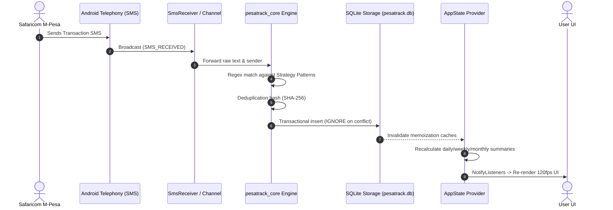

# GanjiPal Data Processing & Ingestion Pipeline

This document details the lifecycle of financial data in GanjiPal—from raw incoming SMS triggers to presentation in reactive UI widgets.

---

## 🔄 End-to-End Ingestion Flow

---

## 🧮 Monetary Precision & Integrity

1. **Integer Minor Units**:
   - All amounts are stored as integer cents (`amountCents`, `feeCents`).
   - Formula: `KSh 1,450.50` -> `145050 cents`.
   - Prevents IEEE 754 floating-point rounding errors during financial aggregation.

2. **Deterministic Deduplication**:
   - Official M-Pesa transactions use reference hashes: `SHA-256("REF:" + mpesaReference)`.
   - Reversal transactions are tagged and link back to original transactions via `reversal_reference`.

3. **Performance & Memoization**:
   - Dashboard aggregations use memoized caches (`_cachedTodaySummary`, `_cachedWeekSummary`, `_cachedMonthSummary`).
   - Cache invalidation occurs automatically on database mutation (`addTransaction`, `editTransaction`, `deleteTransaction`).
